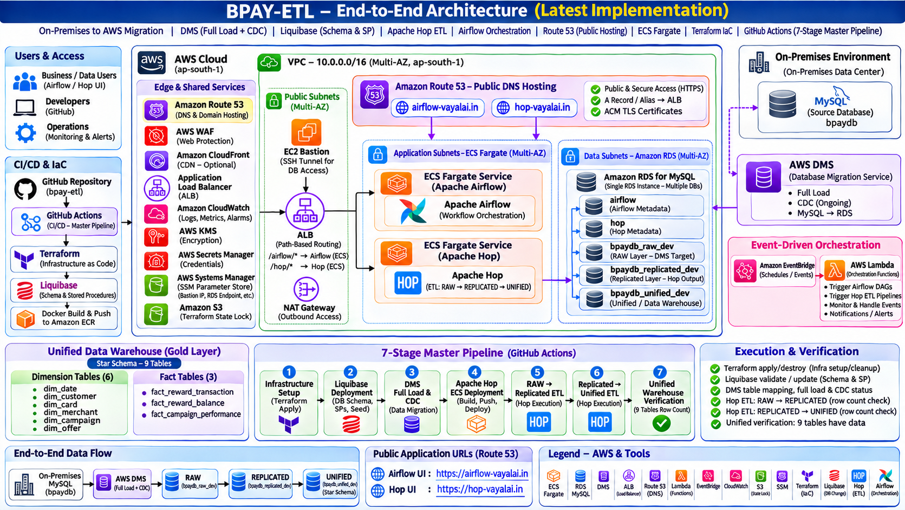
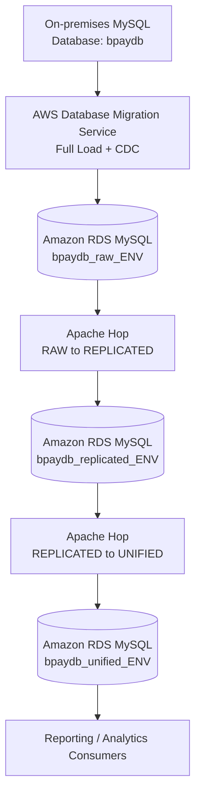
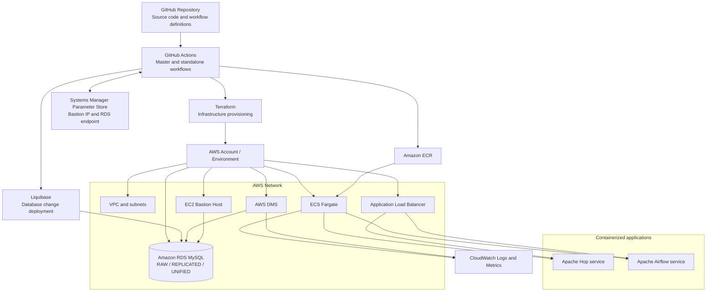
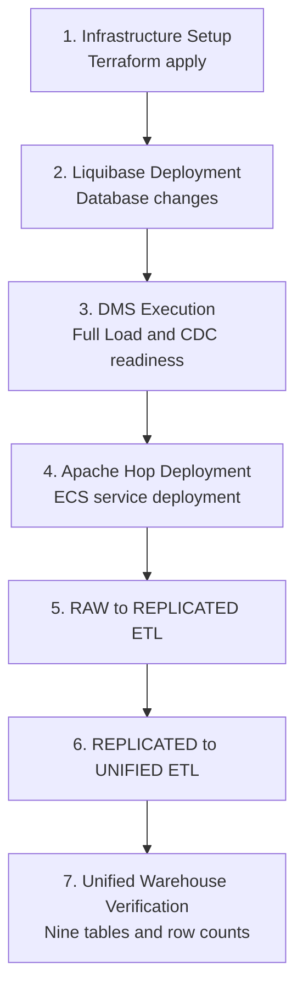

### Updated architecture diagram

The latest architecture diagram includes Route 53 public DNS hosting for both application endpoints:

- `airflow-vayalai.in` → ALB → Airflow ECS service (`/airflow/*`)
- `hop-vayalai.in` → ALB → Apache Hop ECS service (`/hop/*`)

Replace `assets/ARCHITECTURE.png` in the repository with the updated diagram supplied alongside this README.

# BPAY ETL --- Enterprise Data Migration & Unified Analytics Platform

## 1. Overview

BPAY ETL is a cloud-native data migration, ETL, and orchestration
platform on AWS. It migrates data from an on-premises MySQL source into
AWS, processes it through RAW and REPLICATED layers, and builds a
UNIFIED dimensional warehouse for reporting and analytics.

### Core technologies

-   **AWS Database Migration Service (DMS):** Full-load and change data
    capture (CDC) from the on-premises MySQL source.
-   **Amazon RDS for MySQL:** Hosts the RAW, REPLICATED, and UNIFIED
    databases.
-   **Liquibase:** Version-controls and deploys database schemas, stored
    procedures, and other database changes.
-   **Apache Hop:** Implements data integration pipelines and workflow
    orchestration.
-   **Amazon ECS Fargate:** Runs the Apache Hop and Apache Airflow
    services.
-   **Apache Airflow:** Supports DAG-based scheduling and orchestration.
-   **Terraform:** Provisions AWS infrastructure.
-   **GitHub Actions:** Automates infrastructure, Liquibase, DMS, Hop
    deployment, ETL execution, and verification.
-   **Supporting AWS services:** VPC, EC2 bastion, ECR, Application Load
    Balancer, IAM, Route 53, CloudWatch, S3, DynamoDB state locking, and
    Systems Manager Parameter Store.

The repository supports environment-specific deployment for `dev`,
`staging`, and `prod`.

------------------------------------------------------------------------

## 2. Architecture

### Architecture diagram




### 2.1 End-to-end data architecture


### 2.2 Platform and deployment architecture



### 2.3 Database layers

  -----------------------------------------------------------------------------------
  Layer                   Database naming pattern             Purpose
  ----------------------- ----------------------------------- -----------------------
  Source                  `bpaydb`                            On-premises MySQL
                                                              source

  RAW                     `bpaydb_raw_<environment>`          DMS landing/replication
                                                              target

  REPLICATED              `bpaydb_replicated_<environment>`   Data prepared by the
                                                              existing
                                                              RAW-to-REPLICATED Hop
                                                              ETL

  UNIFIED                 `bpaydb_unified_<environment>`      Consolidated
                                                              dimensional warehouse
                                                              and reporting layer
  -----------------------------------------------------------------------------------

For DEV, the AWS databases are:

-   `bpaydb_raw_dev`
-   `bpaydb_replicated_dev`
-   `bpaydb_unified_dev`

The AWS data-layer databases are hosted by the project RDS MySQL
instance. The source `bpaydb` remains on-premises.

### 2.4 Unified warehouse model

The UNIFIED database contains six dimension tables and three fact
tables.

**Dimension tables**

1.  `dim_date`
2.  `dim_customer`
3.  `dim_card`
4.  `dim_merchant`
5.  `dim_campaign`
6.  `dim_offer`

**Fact tables**

1.  `fact_reward_transaction`
2.  `fact_reward_balance`
3.  `fact_campaign_performance`

The final master-workflow verification checks all nine tables and
requires each to contain at least one row. A missing table, SQL error,
or zero-row table causes verification to fail.

------------------------------------------------------------------------

## 3. Liquibase --- Database Change Management

Liquibase manages version-controlled database changes. It is a distinct
part of the deployment process and runs before DMS execution in the
master workflow.

### Responsibilities

-   Create and update database objects.
-   Deploy tables, indexes, stored procedures, and other versioned SQL
    changes.
-   Validate pending changesets before applying updates.
-   Maintain Liquibase deployment history so already-applied changesets
    are not unintentionally applied again.

### GitHub Actions workflow

Workflow: `.github/workflows/liquibase-deploy.yml`

Supported actions:

-   `validate` --- validates the Liquibase changesets against the target
    database.
-   `update` --- applies pending changesets.

The workflow accepts an environment (`dev`, `staging`, or `prod`) and
uses the configured database password and bastion private key secrets.
It connects to the private RDS instance through the bastion SSH tunnel.

### Liquibase execution

For an individual deployment:

1.  Open the repository's **Actions** tab.
2.  Select **Liquibase Deploy**.
3.  Select the target environment.
4.  Select `validate` first.
5.  Review the validation output.
6.  Run `update` after validation succeeds.
7.  Confirm the workflow completes successfully.

The master workflow invokes Liquibase with `action: update` after
Infrastructure Setup.

**Operational note:** The exact changelog path, target schema selection,
and JDBC settings are defined in the repository's Liquibase workflow and
configuration. Use those repository settings rather than substituting an
unverified local command.

------------------------------------------------------------------------

## 4. Apache Hop ETL Workflows

Apache Hop implements the two data transformation stages.

### 4.1 RAW to REPLICATED

-   Reads the DMS landing data from `bpaydb_raw_<environment>`.
-   Executes the existing RAW-to-REPLICATED Hop workflow.
-   Loads prepared data into `bpaydb_replicated_<environment>`.

### 4.2 REPLICATED to UNIFIED

-   Reads source tables from `bpaydb_replicated_<environment>`.
-   Executes the unified warehouse Hop workflow.
-   Loads the six dimension tables and three fact tables into
    `bpaydb_unified_<environment>`.

### 4.3 Supported execution modes

Workflow: `.github/workflows/hop-etl.yml`

  Execution input           Behaviour
  ------------------------- ----------------------------------
  `raw_to_replicated`       Runs RAW-to-REPLICATED ETL
  `replicated_to_unified`   Runs REPLICATED-to-UNIFIED ETL
  `all`                     Runs both ETL stages in sequence

The master workflow calls the two ETL modes as separate jobs. This
provides independent job status and makes it easier to identify which
ETL stage failed.

------------------------------------------------------------------------

## 5. Master CI/CD Workflow

The end-to-end entry point is:

`.github/workflows/master-pipeline.yml`

It is manually triggered from GitHub Actions with an environment input:
`dev`, `staging`, or `prod`.

### 5.1 Seven-stage execution sequence



### 5.2 Stage-by-stage execution and verification

  ----------------------------------------------------------------------------------------
  Stage             Workflow / job           Execution                 What to verify
                                                                       before proceeding
  ----------------- ------------------------ ------------------------- -------------------
  1\.               `infra-setup.yml`        Terraform `apply` for     Terraform apply
  Infrastructure                             selected environment      succeeds; expected
                                                                       outputs are
                                                                       available; bastion
                                                                       and RDS parameters
                                                                       are updated in SSM

  2\. Liquibase     `liquibase-deploy.yml`   Liquibase `update`        Database connection
                                                                       succeeds;
                                                                       validation/update
                                                                       succeeds; no
                                                                       changeset failures

  3\. DMS           `dms-execution.yml`      Start or resume           Replication
                                             replication and monitor   instance is
                                             task                      available;
                                                                       full-load tables
                                                                       complete without
                                                                       errors; task is
                                                                       running and CDC is
                                                                       ready

  4\. Hop           `hop-deploy.yml`         Build/publish image as    ECS service is
  deployment                                 configured and update Hop stable; desired
                                             ECS service               tasks are running;
                                                                       Hop health/status
                                                                       endpoint responds

  5\. RAW to        `hop-etl.yml`            `raw_to_replicated`       Hop workflow
  REPLICATED                                                           succeeds; source
                                                                       and target row
                                                                       counts are
                                                                       sensible; no
                                                                       unexplained
                                                                       rejected rows

  6\. REPLICATED to `hop-etl.yml`            `replicated_to_unified`   Hop workflow
  UNIFIED                                                              succeeds; dimension
                                                                       and fact tables
                                                                       receive data; no
                                                                       unexplained
                                                                       zero-row targets

  7\. Final         Master workflow job      Connect through bastion   Database connection
  verification                               and query all nine        succeeds; all nine
                                             unified tables            tables exist; each
                                                                       has a positive row
                                                                       count; total rows
                                                                       are displayed
  ----------------------------------------------------------------------------------------

The jobs are linked using GitHub Actions `needs` dependencies. If a
stage fails, downstream stages that depend on it do not run.

### 5.3 How to trigger the master workflow

1.  Push the intended workflow and application changes to the branch
    used by the workflow.
2.  Open the GitHub repository.
3.  Select **Actions**.
4.  Select **BPAY-ETL-Master-Pipeline**.
5.  Click **Run workflow**.
6.  Select the environment (`dev`, `staging`, or `prod`).
7.  Trigger the workflow.
8.  Open the run and monitor each of the seven jobs.
9.  Expand failed steps and inspect their logs; do not assume a green
    upstream ETL job proves all target tables contain data.

**Important:** Stage 1 runs Terraform `apply`. Review the Terraform plan
and confirm that it does not contain unexpected replacements or
deletions before allowing the deployment to proceed.

------------------------------------------------------------------------

## 6. Detailed Verification Procedures

Verification should be performed at each layer, not only at the end of
the master workflow.

### 6.1 Infrastructure verification

After Infrastructure Setup succeeds:

-   Confirm the Terraform apply step completed.
-   Confirm expected outputs such as VPC ID, bastion IP, RDS endpoint,
    DMS task ARN, and application endpoints are present.
-   Confirm the SSM parameters exist and contain the current
    environment's values.

For DEV, the parameter names are:

``` text
/bpay-etl/dev/bastion-public-ip
/bpay-etl/dev/rds-endpoint
```

The Infra-Setup GitHub Actions workflow writes these parameters using
AWS CLI `ssm put-parameter`. They are **not Terraform-managed
`aws_ssm_parameter` resources** in the current implementation.

Example read-only checks:

``` bash
aws ssm get-parameter \
  --name "/bpay-etl/dev/bastion-public-ip" \
  --region ap-south-1

aws ssm get-parameter \
  --name "/bpay-etl/dev/rds-endpoint" \
  --region ap-south-1
```

### 6.2 Liquibase verification

In the Liquibase Deploy run, verify:

-   The selected environment is correct.
-   The bastion tunnel and database connection succeed.
-   The `validate` operation reports no validation errors.
-   The `update` operation completes successfully.
-   No changeset is reported as failed.

Review the workflow log for the target database and Liquibase summary.
The precise changeset list depends on the repository's current
changelog.

### 6.3 DMS verification

In the DMS Execution run, verify:

-   The replication instance reaches `available`.
-   The replication task starts or resumes successfully.
-   Full-load tables reach completion.
-   Table statistics show no failed or suspended tables.
-   The task remains running for CDC when CDC is part of the configured
    migration.

A successful task-start command alone is not sufficient; check the task
and table-level status reported by the DMS workflow.

### 6.4 RAW and REPLICATED data verification

Compare representative source and target row counts. For example, after
connecting to RDS through the bastion:

``` sql
SELECT COUNT(*) AS raw_cardholders
FROM bpaydb_raw_dev.cardholders;

SELECT COUNT(*) AS replicated_cardholders
FROM bpaydb_replicated_dev.cardholders;
```

Use the actual source/target table names configured in the DMS and Hop
mappings. Differences may be expected where transformations, filtering,
or load timing apply; investigate unexplained differences.

### 6.5 UNIFIED warehouse verification

Check the nine target tables:

``` sql
SELECT 'dim_date' AS table_name, COUNT(*) AS row_count
FROM bpaydb_unified_dev.dim_date
UNION ALL
SELECT 'dim_customer', COUNT(*)
FROM bpaydb_unified_dev.dim_customer
UNION ALL
SELECT 'dim_card', COUNT(*)
FROM bpaydb_unified_dev.dim_card
UNION ALL
SELECT 'dim_merchant', COUNT(*)
FROM bpaydb_unified_dev.dim_merchant
UNION ALL
SELECT 'dim_campaign', COUNT(*)
FROM bpaydb_unified_dev.dim_campaign
UNION ALL
SELECT 'dim_offer', COUNT(*)
FROM bpaydb_unified_dev.dim_offer
UNION ALL
SELECT 'fact_reward_transaction', COUNT(*)
FROM bpaydb_unified_dev.fact_reward_transaction
UNION ALL
SELECT 'fact_reward_balance', COUNT(*)
FROM bpaydb_unified_dev.fact_reward_balance
UNION ALL
SELECT 'fact_campaign_performance', COUNT(*)
FROM bpaydb_unified_dev.fact_campaign_performance;
```

Expected verification conditions:

1.  All nine tables are queryable.
2.  Every table has a row count greater than zero.
3.  The GitHub Actions verification job prints the count for every
    table.
4.  The total row count is displayed.
5.  The job reports that all nine tables have been verified.

The workflow currently treats a zero-row table as a failure. If a table
is legitimately expected to be empty in a particular environment, its
acceptance criteria should be explicitly agreed and the verification
logic updated deliberately---not bypassed to obtain a green run.

### 6.6 Troubleshooting a zero-row table

A successful Hop workflow status does not necessarily mean that every
target table received data.

For example, if `dim_customer` contains zero rows:

1.  Check the source table in `bpaydb_replicated_dev`.
2.  Check the target table in `bpaydb_unified_dev`.
3.  Inspect the customer dimension Hop pipeline.
4.  Review input rows, transformation/filter results, rejected rows, and
    output rows.
5.  Review lookup/join conditions and source-to-target mappings.
6.  Correct the cause and rerun only the required ETL stage when safe.
7.  Run the final verification again.

Example:

``` sql
SELECT COUNT(*) AS replicated_customer_source
FROM bpaydb_replicated_dev.cardholders;

SELECT COUNT(*) AS unified_customer_target
FROM bpaydb_unified_dev.dim_customer;
```

Use the actual source table and mapping defined by the customer
dimension pipeline if they differ from this example.

------------------------------------------------------------------------

## 7. Individual GitHub Actions Workflows

The repository retains standalone workflows for independent operation
and troubleshooting.

  -----------------------------------------------------------------------
  Workflow                            Responsibility
  ----------------------------------- -----------------------------------
  `master-pipeline.yml`               End-to-end seven-stage
                                      orchestration

  `infra-setup.yml`                   Terraform verify, plan, apply, and
                                      destroy

  `liquibase-deploy.yml`              Liquibase validate and update

  `dms-execution.yml`                 DMS full-load and CDC
                                      execution/readiness checks

  `hop-deploy.yml`                    Apache Hop ECS deployment

  `hop-etl.yml`                       Selectable Hop ETL execution

  `airflow-deploy.yml`                Airflow ECS deployment

  `bootstrap.yml`                     Initial/bootstrap operations

  `infra-destroy-schedule.yml`        Scheduled
                                      infrastructure-destruction workflow
  -----------------------------------------------------------------------

Airflow deployment and scheduled infrastructure destruction remain
separate from the current master workflow.

------------------------------------------------------------------------

## 8. AWS Infrastructure and Supporting Services

  -----------------------------------------------------------------------
  AWS service/resource                Role
  ----------------------------------- -----------------------------------
  VPC and subnets                     Network isolation and connectivity

  EC2 bastion host                    SSH access path to private RDS

  Amazon RDS for MySQL                Hosts RAW, REPLICATED, UNIFIED, and
                                      supporting databases

  AWS DMS                             Full-load and CDC replication

  Amazon ECS Fargate                  Runs Apache Hop and Airflow
                                      services

  Amazon ECR                          Stores container images

  Application Load Balancer           Routes application traffic

  IAM                                 Service roles and deployment
                                      permissions

  Amazon CloudWatch                   Application and infrastructure
                                      logs/monitoring

  Route 53                            DNS records for configured
                                      endpoints

  Systems Manager Parameter Store     Stores environment-specific bastion
                                      IP and RDS endpoint

  Amazon S3                           Terraform remote state and
                                      configured project artifacts

  DynamoDB                            Terraform state locking, as
                                      configured by the backend
  -----------------------------------------------------------------------

### Public DNS and application access — Amazon Route 53

Amazon Route 53 hosts the public DNS records used to access the Airflow and Apache Hop web interfaces.

| Public hostname | Application | Routing |
|---|---|---|
| `airflow-vayalai.in` | Apache Airflow UI | Route 53 record → Application Load Balancer (ALB) → `/airflow/*` path rule → Airflow ECS service |
| `hop-vayalai.in` | Apache Hop UI / platform endpoint | Route 53 record → Application Load Balancer (ALB) → `/hop/*` path rule → Hop ECS service |

The ALB performs path-based routing to the corresponding ECS Fargate service. Route 53 provides public DNS resolution; it does not itself host the applications. The ALB and application services handle the incoming web traffic.

Use HTTPS URLs when the corresponding listener, certificate, and DNS configuration are enabled:

- Airflow: `https://airflow-vayalai.in`
- Apache Hop: `https://hop-vayalai.in`

If HTTPS has not yet been configured for an environment, use the actual scheme and hostname exposed by that environment. Do not assume that a DNS record alone enables HTTPS.

### Terraform state

Terraform uses an S3 remote backend with state locking. The state key is
environment-specific. DEV uses:

``` text
s3://jungle-terraform-bucket/bpay-etl/dev/terraform.tfstate
```

Use the repository's backend configuration and environment-specific
variables. Do not manually restore historical state versions as a
substitute for reconciling live infrastructure and current state.

------------------------------------------------------------------------

## 9. Apache Hop and Airflow Services

### Apache Hop

Apache Hop runs as an ECS Fargate service. The deployment workflow
updates the environment-specific Hop service. The ETL workflow invokes
the selected execution mode.

Hop assets are maintained under `hop-orchestration/`, including
workflows, pipelines, JDBC drivers, configuration, scripts, and
Docker-related files.

### Apache Airflow

Apache Airflow runs separately as an ECS Fargate service and supports
DAG-based scheduling and orchestration. It is deployed by
`airflow-deploy.yml` and is not one of the seven stages in the current
master workflow.

------------------------------------------------------------------------

## 10. Repository Structure

``` text
bpay-etl/
├── .github/
│   └── workflows/
│       ├── master-pipeline.yml
│       ├── infra-setup.yml
│       ├── liquibase-deploy.yml
│       ├── dms-execution.yml
│       ├── hop-deploy.yml
│       ├── hop-etl.yml
│       ├── airflow-deploy.yml
│       ├── bootstrap.yml
│       └── infra-destroy-schedule.yml
│
├── airflow-orchestration/
│   ├── dags/
│   ├── plugins/
│   ├── docker/
│   └── ...
│
├── hop-orchestration/
│   ├── workflows/
│   ├── pipelines/
│   ├── jdbc/
│   ├── config/
│   ├── scripts/
│   └── docker/
│
├── infra/
│   ├── environments/
│   ├── modules/
│   ├── backend.tf
│   └── main.tf
│
└── README.md
```

Directory contents may evolve as the project develops.

------------------------------------------------------------------------

## 11. Deployment and Operational Safeguards

-   Confirm the selected environment before every infrastructure or
    database operation.
-   Review Terraform plans before applying or destroying resources.
-   A Terraform destroy can remove RDS and its data. Take and verify a
    backup/snapshot first if the data must be retained.
-   Do not rerun the entire master workflow merely to troubleshoot final
    verification. Inspect the failed table and rerun only the required
    stage when safe.
-   A green ETL job does not prove that every target table contains
    data; use row-count verification.
-   Do not manually restore old Terraform state versions without
    reconciling live AWS resources and the current backend state.
-   Keep credentials in GitHub Secrets or approved secret-management
    services; do not commit passwords, private keys, or access keys.

------------------------------------------------------------------------

## 12. Technologies

-   Amazon Web Services (AWS)
-   AWS DMS
-   Amazon RDS for MySQL
-   Amazon ECS Fargate
-   Amazon ECR
-   Application Load Balancer
-   Amazon VPC, EC2, IAM, Route 53
-   AWS Systems Manager Parameter Store
-   Amazon S3 and DynamoDB
-   Amazon CloudWatch
-   Terraform
-   GitHub Actions
-   Liquibase
-   Apache Hop
-   Apache Airflow
-   Docker
-   MySQL

------------------------------------------------------------------------

## 13. Future Enhancements

Potential improvements include:

-   HTTPS with AWS Certificate Manager.
-   More comprehensive data-quality and source-to-target reconciliation
    checks.
-   Automated source-to-target row-count validation.
-   Improved failure notifications and operational dashboards.
-   More granular IAM permissions and secret management.
-   Controlled promotion and approval gates between DEV, STAGING, and
    PROD.
-   Additional recovery and backup automation.

------------------------------------------------------------------------

## Author

Vadivel P M

Cloud \| DevOps \| Data Platform Engineering